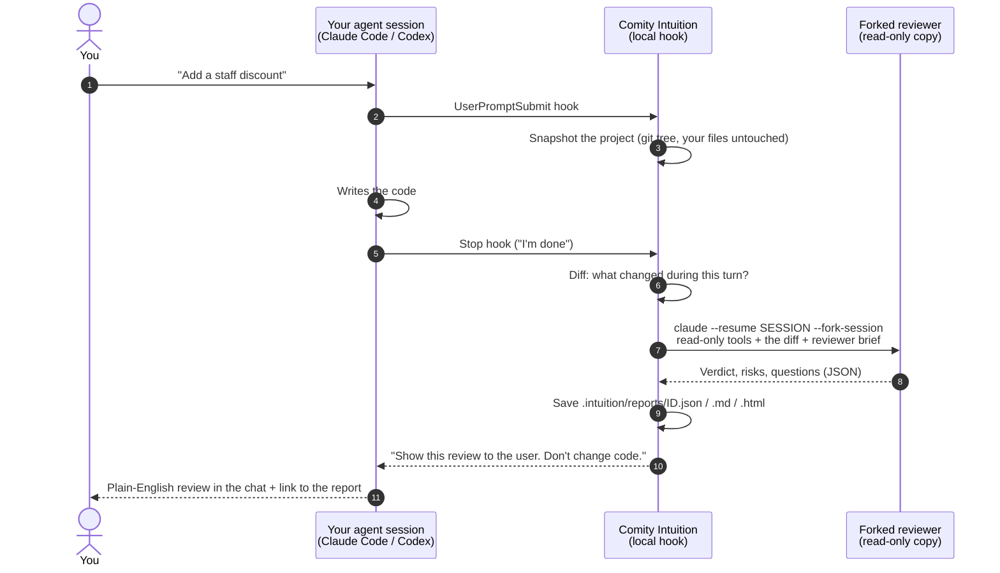

# Comity Intuition

**Your AI's gut check before you ship.**

You asked an AI coding agent for a feature and it says "Done!". But is it safe to ship? Comity Intuition answers that in plain English, every time the agent finishes.

When Claude Code (or Codex) finishes a task, a **forked copy of that same agent session** reviews the changes with fresh eyes. Because it's a copy, it already knows what you asked for, what the agent tried and why. Then it explains the result to you like a calm senior developer would, without jargon:

- **What changed**, in terms of your product and your users
- **Business risks**: money, customer data, privacy, security, reliability, legal, cost
- **A verdict**: 🟢 safe to ship · 🟡 check with a developer first · 🔴 don't ship yet
- **Questions to ask a developer**, ready to copy and paste

It's free and open source. It runs on your computer with the AI subscription you already have. You don't need a Comity account, nothing goes to a server, and there's no telemetry.


<sub>A real report: Claude Code added a staff discount, and its forked reviewer caught that any shopper could claim to be staff. [Open the HTML](https://github.com/comityhq/intuition/blob/main/examples/staff-discount-red.html).</sub>

## Who it's for

- **Founders who build with AI.** You can ship features without reading code. Intuition tells you when you need a second pair of eyes.
- **Managers and business owners** whose developers use AI agents. You get a readable summary of every AI-made change and the risk that comes with it, which you can forward to anyone.

## 30-second install

You need [Node.js 22+](https://nodejs.org), git, and [Claude Code](https://claude.com/claude-code) and/or [Codex](https://developers.openai.com/codex).

```bash
cd your-project
npx comity-intuition init        # adds the hooks to .claude/settings.json
```

That's it. Next time Claude Code finishes a task that changed code, you'll see the review in the chat.

Want a review right now, without waiting for the agent?

```bash
npx comity-intuition review --open
```

<details>
<summary>Install from source (no npm)</summary>

```bash
git clone https://github.com/comityhq/intuition.git comity-intuition && cd comity-intuition
npm install && npm run build
npm link                         # makes `comity-intuition` and `intuition` available everywhere
cd your-project && comity-intuition init
```
</details>

Using Codex? Run `npx comity-intuition init --agent codex` (or `--agent all` for both), then approve the two hooks once in Codex's `/hooks`. See [Codex](#codex) below.

Preview what `init` would change without writing anything: `npx comity-intuition init --dry-run`.

## How it works



In plain words:

1. **Before each task**, Intuition takes a quiet snapshot of your project. It uses git's own storage and doesn't change your files, your staging area or your branches.
2. **When the agent says it's done**, Intuition works out exactly what changed during that task. If nothing changed (a pure Q&A turn), it stays silent.
3. **A forked copy of the session reviews the work.** It has the full memory of the conversation but only read-only tools. It can read and search files, and that's all: it can't edit, can't run commands and has no internet access. The original session isn't changed.
4. **The agent shows you the review** in the chat, close to word for word. A polished HTML one-pager is saved next to it so you can open it or forward it.
5. **No loops.** The reviewer never triggers another review, a follow-up turn never re-reviews the same changes, and a review that fails tells you so without blocking your agent.

### What you see in the chat

```text
Review: 🔴 Don't ship yet
In short: The staff discount and the $5 international shipping both work, but anyone can claim to be staff and get 50% off.

Things to check
- High risk (money): any shopper can get the 50% staff discount. Checkout decides who's staff from a "staff"
  flag the shopper's own browser sends, and the server never checks it...
- Medium risk (reliability): existing checkouts will start failing...

Questions to settle
1. How will checkout confirm that someone using STAFF50 is really an employee?
...
Full report: .intuition/reports/2026-10-21T18-18-29-b22d1d.html
```

## Reviewers: same agent, other vendor, or both

| Setting | Who reviews | What it knows |
| --- | --- | --- |
| `reviewer: same` (default) | A **fork** of the agent that did the work | Everything: the conversation, the files it read, its reasoning |
| `reviewer: codex` / `claude` / `gemini` | A fresh session from that agent | The changes, plus a short excerpt of the original conversation (what you asked for and what the agent said) |
| `secondOpinion: codex` (etc.) | Both of the above, **in parallel** | You get both verdicts in the chat and two reports |

A second opinion from another vendor catches different blind spots. A model reviewing its own fork can share its own assumptions.

```bash
comity-intuition config set secondOpinion codex      # every turn: Claude reviews itself, Codex double-checks
comity-intuition review --reviewer codex              # one-off cross-vendor review of the current changes
comity-intuition review --session last --since last-turn --reviewer codex
```

### Codex

`init --agent codex` writes `.codex/hooks.json` with the same two hooks. Codex is careful about running hooks from a project:

- The project must be **trusted** in Codex (Codex asks the first time you open it).
- Codex asks you to **review and trust new hooks**: open Codex in the project and approve the two Comity Intuition hooks in `/hooks`.
- For unattended runs (`codex exec`), `--dangerously-bypass-hook-trust` runs enabled hooks without the trust prompt.

When Codex finishes, the review comes back through Codex's Stop hook (`decision: "block"`), and Codex shows it to you. A Codex session is reviewed by a fork of itself (`codex exec fork <session>`, read-only sandbox, no approvals).

### Gemini CLI (optional)

If `gemini` is on your PATH you can use `--reviewer gemini` or `secondOpinion gemini`. It runs headless in read-only plan mode with the diff and the conversation excerpt. Gemini can't fork a Claude or Codex session.

## Commands

```text
comity-intuition init      [--agent claude|codex|all] [--scope project|user] [--dry-run]
comity-intuition review    [--repo <path>] [--since <ref>|last-turn] [--reviewer same|claude|codex|gemini]
                           [--session <id>|last] [--json] [--open]
comity-intuition report    [--last | <id>] [--open] [--json]
comity-intuition doctor
comity-intuition uninstall [--agent claude|codex|all] [--scope project|user] [--purge] [--dry-run]
comity-intuition config    get [key] | set <key> <value> | unset <key> | path     [--user]
```

`intuition` is a shorter alias for `comity-intuition`.

- `review` with no options reviews **all uncommitted changes** (compared with your last commit, new files included). `--since main` reviews everything since a branch. `--since last-turn` reviews from the start of the agent's last turn.
- `review --session <id>` gives the reviewer that session's context. The same vendor forks the session, and a different vendor reads its transcript.
- `--json` prints exactly the report JSON (schema below) and nothing else on stdout. Exit codes: `0` reviewed, `1` error, `2` nothing to review.
- `init --scope user` installs the hooks for every project (`~/.claude/settings.json`). Project scope is the default. Commit `.claude/settings.json` if you want your whole team to get reviews.

## Configuration

Settings live in `<project>/.intuition/config.json` (just you, this project) and in your user config folder (`--user`: `%APPDATA%\comity-intuition`, `~/Library/Application Support/comity-intuition` or `~/.config/comity-intuition`). Project settings win. `INTUITION_*` environment variables win over both.

| Key | Default | What it does |
| --- | --- | --- |
| `enabled` | `true` | Turn automatic reviews on or off (`INTUITION_DISABLED=1` also turns them off) |
| `reviewer` | `same` | `same`, `claude`, `codex` or `gemini` |
| `secondOpinion` | `none` | Another agent that reviews in parallel |
| `language` | `English` | Language of the review, e.g. `Spanish` |
| `presentInChat` | `true` | Have the agent relay the review in chat. `false` only shows a one-line status |
| `openReport` | `false` | Open the HTML report in your browser after each review |
| `timeoutSec` | `300` | Maximum time for one review |
| `maxDiffChars` | `120000` | Bigger changes are summarised (the report says `truncated: true`) |
| `claudeModel` / `codexModel` / `geminiModel` | agent default | Pick a reviewer model, e.g. `sonnet` to make reviews cheaper |
| `claudeSettingSources` | Claude default | Passed to `claude --setting-sources` for the reviewer, e.g. `project,local` |
| `codexIgnoreUserConfig` | `false` | Start Codex reviewers without your personal `config.toml` (no MCP servers or plugins, default model) |

Environment variables: `INTUITION_TIMEOUT_SEC`, `INTUITION_CLAUDE_MODEL`, `INTUITION_CODEX_MODEL`, `INTUITION_GEMINI_MODEL`, `INTUITION_CLAUDE_SETTING_SOURCES`, `INTUITION_CODEX_IGNORE_USER_CONFIG`, `INTUITION_REVIEWER`, `INTUITION_LANGUAGE`, `INTUITION_DISABLED`, `INTUITION_CLAUDE_BIN` / `INTUITION_CODEX_BIN` / `INTUITION_GEMINI_BIN` (custom executable), `INTUITION_HOME` (user config folder), `INTUITION_DEBUG=1`.

## Report format

Every review is saved as `<project>/.intuition/reports/<id>.json`, `.md` and `.html`. The folder ignores itself in git (`.intuition/.gitignore`), so reports are never committed by accident.

```jsonc
{ "version": 1, "id": "2026-10-21T18-18-29-b22d1d", "created_at": "2026-10-21T18:18:29.441Z",
  "repo": "/Users/founder/tiny-shop", "base": "<git commit or tree id>", "head": "<tree id>" /* null = working tree */,
  "reviewer": { "agent": "claude", "model": "claude-opus-5-5", "forked_from_session": "245181b6-…" },
  "verdict": "red",                 // green = safe to ship, yellow = ask a developer about X, red = don't ship yet
  "headline": "…", "what_changed": ["…"],
  "risks": [ { "level": "high", "category": "money", "title": "…", "explanation": "…",
               "where": ["src/pricing.js"], "confidence": "high" } ],
  "questions_for_developer": ["…"], "good_news": ["…"],
  "files_reviewed": ["src/pricing.js"], "truncated": false }
```

Verdicts are kept consistent. A 🔴 always comes with at least one high risk the reviewer is confident about, and a 🟢 can't sit on top of one. A 🟡 always names at least one medium or high risk, so a review with only minor notes stays 🟢. See [examples/](examples/) for complete reports.

## Privacy and safety

- **Everything runs locally.** Intuition is a command-line program and a pair of agent hooks. There's no Comity server, account, analytics or telemetry. Your code never goes to Comity.
- **Your agent, your subscription.** Reviews go through the `claude` / `codex` / `gemini` program you already use. Your code goes to the same AI provider, under the same terms, as when your agent wrote it.
- **The reviewer is read-only.**
  - Claude Code reviewers get `--tools Read,Grep,Glob`, editing and shell tools explicitly denied, `--permission-mode dontAsk`, no MCP servers, hooks disabled, and `--no-session-persistence`, so the fork doesn't clutter your `/resume` list.
  - Codex reviewers run in the `read-only` sandbox with approvals set to `never`.
  - Anything written inside your code or the conversation is treated as material to review, never as instructions.
- **Your git repository is left alone.** Snapshots use a temporary index file inside `.git` and write ordinary git objects. They don't change your files, staging area, branches or history. New files over 2 MB are listed by name and not read.
- **Secrets**: the reviewer is told never to copy secret values into a report.

## What it costs

Intuition itself is free. Reviews run on **your own agent subscription** (Claude Code or Codex plan, or API key): a review is roughly **one extra agent turn**. A forked reviewer re-reads the session, so long sessions cost a bit more; set `claudeModel` to `sonnet` (or `codexModel`) for cheaper reviews. Turns that changed no code cost nothing.

## FAQ

**Does it slow my agent down?** The review starts when the agent finishes, and usually takes 20 seconds to 2 minutes. Claude Code shows "Comity Intuition: reviewing the changes in plain English" while it runs. Turns that didn't change code are skipped instantly.

**Will it cry wolf?** It's built not to. The reviewer is told to raise only risks it can point to in *this* change, with a concrete way things go wrong. It doesn't report style nits or generic advice, and it says how confident it is about each risk. Small, safe changes get a short 🟢 review.

**Can the reviewer break something?** No. It has no tools that can change files or run commands (see Privacy and safety).

**Does it work on Windows?** Yes. It was developed and run end to end on Windows, with both Claude Code and Codex hooks. It only uses Node.js and git, so macOS and Linux are supported as well, but they haven't had the same end-to-end runs yet.

**Can I turn it off for a while?** `comity-intuition config set enabled false` turns it off for this project. `INTUITION_DISABLED=1` turns it off for one terminal. `comity-intuition uninstall` removes the hooks.

**Monorepos and subfolders?** Intuition reviews the git repository that contains the agent's working folder.

**Does it commit or push anything?** Never.

**Something's not working.** Run `comity-intuition doctor`. Hook problems are logged in `.intuition/hook.log`.

## Known limitations

- Gemini CLI support follows Gemini's documented headless flags but hasn't been run here. Gemini can't fork sessions, so it reviews with the conversation excerpt.
- Codex only runs project hooks in a trusted project, after you approve them in `/hooks`. Codex users on a ChatGPT plan whose personal `config.toml` sets a model their plan can't use should set `codexModel` or `codexIgnoreUserConfig`.
- The Stop hook waits for the review before handing control back to you. On a slow connection this can take a couple of minutes (`timeoutSec` caps it).
- Very large changes are summarised. The reviewer can still open any file, but its review is only as good as what it reads.

## Does it actually catch things? (eval)

A 31-case benchmark of small real-world projects: 20 changes with a planted problem (discount abuse, SQL injection, plaintext passwords, leaked keys, …) and 11 harmless changes that should stay 🟢. Full results: [eval/results/2026-10-21.md](eval/results/2026-10-21.md).

| Reviewer | Pass | Planted problems caught | Harmless changes kept 🟢 |
| --- | --- | --- | --- |
| Claude Code (`review`) | **31/31** | 20/20 | 11/11 |
| Claude Code, real Stop hook | **8/8** | 4/4 | 4/4 |
| Claude Haiku as reviewer | 31/31 | 20/20 | 11/11 |
| Codex (`review`) | 30/31 | 19/20 | 11/11 |

Run it yourself (uses your agent subscription): `npm run build && npm run eval -- --reviewer claude`. Raw reviewer outputs are in `eval/results/raw/`; `npm run eval:rescore` re-scores the saved reports and regenerates the summary without calling any AI.

## Contributing

Issues and pull requests are welcome; see [CONTRIBUTING.md](CONTRIBUTING.md). Security reports: [SECURITY.md](SECURITY.md). MIT licensed.

---

**Built by [Comity](https://comity.so): coordination for teams of AI agents → [comity.so](https://comity.so)**
